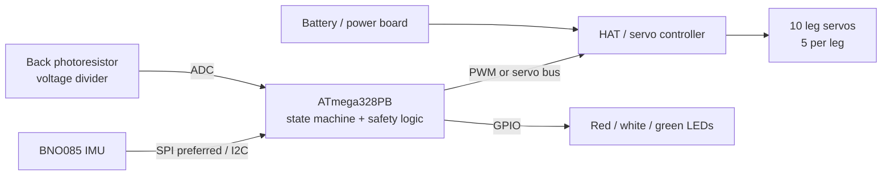
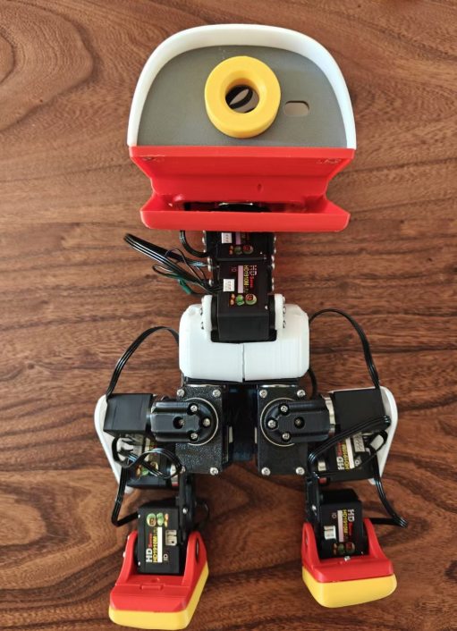
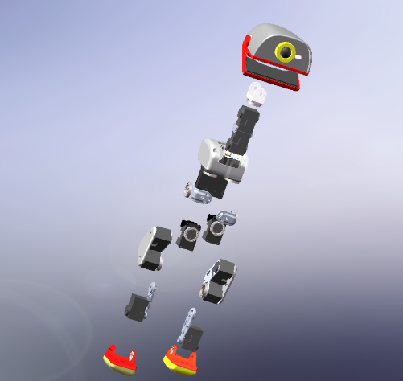
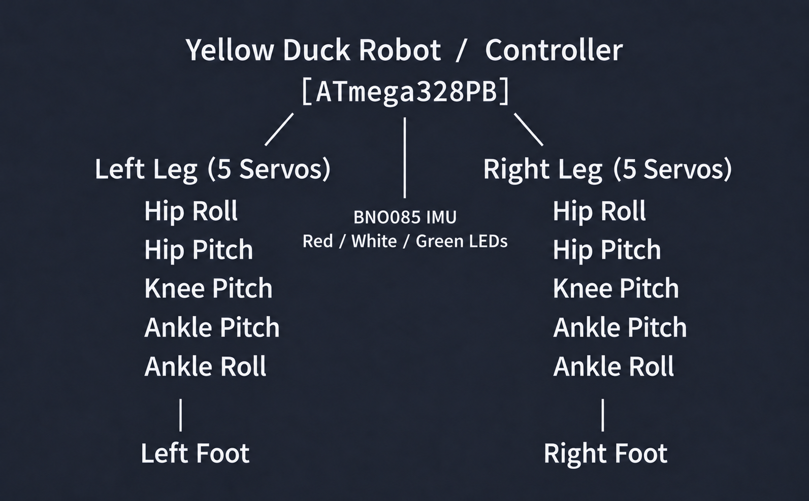
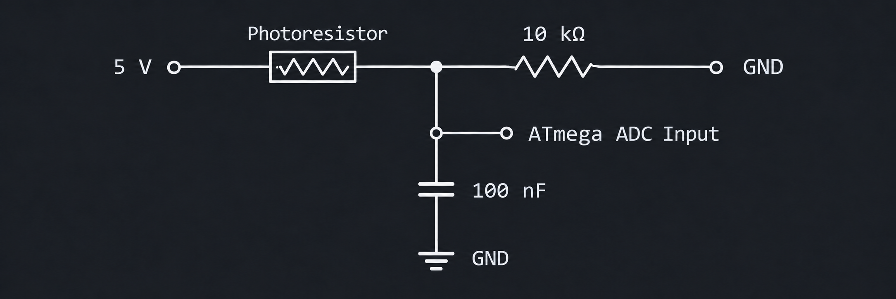

# Final Project

**Team Number: T29**

**Team Name: YELLOW DUCK**

| Team Member Name | Email Address                    |
| ---------------- | -------------------------------- |
| [Zichao Di]      | [zhichaod@engineering.upenn.edu] |
| [Lingran Zhang]  | [lingranz@engineering.upenn.edu] |
| [Yixuan Ji]      | [ji6@engineering.upenn.edu]      |

**GitHub Repository URL:[github.com/upenn-embedded/ese5190f26-finalproject-t29](https://github.com/upenn-embedded/ese5190f26-finalproject-t29)**

**GitHub Pages Website URL:** [for final submission]*

## Final Project Proposal

### 1. Abstract

This project develops a minimum viable yellow duck robot that can walk continuously using ten leg servos, stop safely when a hand covers a photoresistor on its back, and resume walking when the photoresistor is uncovered. Each leg has five actuated degrees of freedom: hip roll, hip pitch, knee pitch, ankle pitch, and ankle roll. A BNO085 inertial measurement unit (IMU) monitors the robot's attitude and prevents unsafe motion after excessive tilting or a communication failure.

The project is implemented in bare-metal, register-level C on an ATmega328PB. The HAT and servo controller are limited to power distribution, interface expansion, level shifting, and low-level communication. All application-level decisions are made by the ATmega328PB.

Future advanced versions may add a Radxa Zero 3W single-board computer, based on the RK3566 processor, as an upper-level edge-computing platform for vision, audio, networking, and higher-level decision making.

### 2. Motivation

This project was inspired by a recently released Hugging Face video of a yellow duck robot. We find the combination of a playful character form with bipedal robotics especially engaging. The reference project has made selected resources openly available, which helps us understand its implementation direction. However, fully reproducing the complete system remains challenging because it combines mechanical design, coordinated multi-servo control, sensing, and software deployment.

We therefore begin with a verifiable and achievable baseline: a yellow duck robot that can stand stably and walk. A photoresistor, BNO085, and safety state machine make its stop-and-resume behavior reliable. If sufficient time remains after the baseline is complete, we will incrementally add advanced capabilities such as ToF obstacle avoidance, audio interaction, and camera-based perception.

#### Core Features

- Ten-servo biped walking: five active joints per leg
- Back-mounted photoresistor for hand-cover stop and automatic resume
- BNO085 attitude monitoring and fall protection
- Red, white, and green status LEDs
- Bare-metal state machine, timers, interrupts, ADC processing, and sensor communication
- Safe stopping at a stable double-support posture

### 3. System Block Diagram



<div align="center">
<table style="display: inline-table; width: auto; max-width: 100%; text-align: left;">
  <thead>
    <tr>
      <th>Component</th>
      <th>Function</th>
      <th>Interface</th>
    </tr>
  </thead>
  <tbody>
    <tr>
      <td>ATmega328PB</td>
      <td>State machine, gait scheduling, light detection, attitude safety, LED control, and fault handling</td>
      <td>GPIO, ADC, timers, SPI/I2C, servo interface</td>
    </tr>
    <tr>
      <td>Ten leg servos, five per leg</td>
      <td>Hip, knee, and ankle motion for weight transfer, swing, clearance, and foot leveling</td>
      <td>PWM or servo bus</td>
    </tr>
    <tr>
      <td>BNO085 IMU</td>
      <td>Roll, pitch, rotation vector, and motion status</td>
      <td>SPI preferred; I2C acceptable</td>
    </tr>
    <tr>
      <td>Photoresistor</td>
      <td>Detects whether a hand covers the robot's back</td>
      <td>Analog voltage divider to ADC</td>
    </tr>
    <tr>
      <td>Red, white, and green LEDs</td>
      <td>Indicate operating state and faults</td>
      <td>GPIO</td>
    </tr>
    <tr>
      <td>HAT / servo controller</td>
      <td>Power distribution, interface expansion, level shifting, and low-level servo transport</td>
      <td>Hardware dependent</td>
    </tr>
  </tbody>
</table>
</div>

### 4. Design Sketches

<p align="center">
  
  
</p>
<p align="center"><em>Overall assembly (left) and exploded view (right).</em></p>

#### Ten-Servo Leg Layout

The two legs use ten servos in total: five active joints per leg.

<div align="center">
<table style="display: inline-table; width: auto; max-width: 100%; text-align: left;">
  <thead>
    <tr>
      <th>Servo</th>
      <th>Mechanical Role</th>
    </tr>
  </thead>
  <tbody>
    <tr>
      <td>Left hip roll servo</td>
      <td>Tilts the pelvis laterally and transfers the center of mass toward the left foot</td>
    </tr>
    <tr>
      <td>Left hip pitch servo</td>
      <td>Moves the left thigh forward and backward</td>
    </tr>
    <tr>
      <td>Left knee pitch servo</td>
      <td>Bends the leg to provide foot clearance during swing</td>
    </tr>
    <tr>
      <td>Left ankle pitch servo</td>
      <td>Levels the left foot for landing and push-off</td>
    </tr>
    <tr>
      <td>Left ankle roll servo</td>
      <td>Maintains lateral foot contact during weight transfer</td>
    </tr>
    <tr>
      <td>Right hip roll servo</td>
      <td>Tilts the pelvis laterally and transfers the center of mass toward the right foot</td>
    </tr>
    <tr>
      <td>Right hip pitch servo</td>
      <td>Moves the right thigh forward and backward</td>
    </tr>
    <tr>
      <td>Right knee pitch servo</td>
      <td>Bends the leg to provide foot clearance during swing</td>
    </tr>
    <tr>
      <td>Right ankle pitch servo</td>
      <td>Levels the right foot for landing and push-off</td>
    </tr>
    <tr>
      <td>Right ankle roll servo</td>
      <td>Maintains lateral foot contact during weight transfer</td>
    </tr>
  </tbody>
</table>
</div>

<p align="center"></p>

#### Walking Cycle

1. Lean the pelvis to the left using the hip-roll joints and transfer the center of mass onto the left foot.
2. Flex the right knee, swing the right hip forward, and level the right foot with the ankle joints.
3. Extend the right knee and return the pelvis toward the center so the right foot lands in double support.
4. Lean the pelvis to the right and transfer the center of mass onto the right foot.
5. Flex the left knee, swing the left hip forward, and level the left foot with the ankle joints.
6. Extend the left knee and return the pelvis toward the center so the left foot lands and the cycle repeats.

The first tuning objective is reliable center-of-mass transfer. Stride length should remain small until the robot can repeatedly shift its weight without falling.

#### Photoresistor Stop Control

The photoresistor is mounted on the robot's back in a clearly defined location that can be covered consistently by one hand.

#### Circuit Design

<p align="center"></p>

#### Signal Processing

<div align="center">
<table style="display: inline-table; width: auto; max-width: 100%; text-align: left;">
  <thead>
    <tr>
      <th>Parameter</th>
      <th>Initial Value</th>
    </tr>
  </thead>
  <tbody>
    <tr>
      <td>ADC sampling rate</td>
      <td>100 Hz, one sample every 10 ms</td>
    </tr>
    <tr>
      <td>Digital filter</td>
      <td>8-sample moving average or equivalent IIR filter</td>
    </tr>
    <tr>
      <td>Startup calibration</td>
      <td>2 seconds with the sensor uncovered</td>
    </tr>
    <tr>
      <td>Stop threshold</td>
      <td>40% of the uncovered baseline</td>
    </tr>
    <tr>
      <td>Resume threshold</td>
      <td>60% of the uncovered baseline</td>
    </tr>
    <tr>
      <td>Cover confirmation time</td>
      <td>200 ms</td>
    </tr>
    <tr>
      <td>Resume confirmation time</td>
      <td>500 ms</td>
    </tr>
  </tbody>
</table>
</div>

The separate stop and resume thresholds provide hysteresis. The ambient-light baseline must be frozen while the sensor is covered so that the covered state cannot be learned as a new normal condition.

#### Safe Stop Behavior

When a cover is confirmed, the robot must:

1. Refuse to begin another half-step.
2. Complete the current half-step and reach double support.
3. Return smoothly to the neutral standing pose within a target of 0.5 seconds.
4. Enter `STOPPED` and illuminate the white LED.

After the sensor has remained uncovered for 500 ms, the robot checks the BNO085 safety conditions. If the posture is safe, walking resumes automatically.

#### BNO085 Attitude Protection

The IMU is used for monitoring and safety rather than complex dynamic balance.

<div align="center">
<table style="display: inline-table; width: auto; max-width: 100%; text-align: left;">
  <thead>
    <tr>
      <th>Condition</th>
      <th>Initial Threshold</th>
      <th>Response</th>
    </tr>
  </thead>
  <tbody>
    <tr>
      <td>Normal</td>
      <td>Absolute roll and pitch below 15 degrees</td>
      <td>Continue walking</td>
    </tr>
    <tr>
      <td>Warning</td>
      <td>Absolute roll or pitch between 15 and 25 degrees</td>
      <td>Reduce stride and stop after the current half-step</td>
    </tr>
    <tr>
      <td>Fall</td>
      <td>Absolute roll or pitch above 25 degrees</td>
      <td>Enter <code>FALL</code> and stop gait generation</td>
    </tr>
    <tr>
      <td>Recovery</td>
      <td>Absolute roll and pitch below 10 degrees for 1 second</td>
      <td>Permit re-standing</td>
    </tr>
  </tbody>
</table>
</div>

The BNO085 should be read at 25-50 Hz. Thresholds must be tuned experimentally after the final mechanical structure is assembled. A BNO085 timeout or communication failure must prohibit walking.

#### Operating State Machine

<div align="center">
<table style="display: inline-table; width: auto; max-width: 100%; text-align: left;">
  <thead>
    <tr>
      <th>State</th>
      <th>Behavior</th>
      <th>Exit Condition</th>
    </tr>
  </thead>
  <tbody>
    <tr>
      <td><code>BOOT</code></td>
      <td>Initialize clocks, GPIO, ADC, timers, and communication interfaces</td>
      <td>Initialization complete</td>
    </tr>
    <tr>
      <td><code>SELF_TEST</code></td>
      <td>Check the BNO085, photoresistor, and all ten servos</td>
      <td>All checks pass, otherwise <code>ERROR</code></td>
    </tr>
    <tr>
      <td><code>STAND</code></td>
      <td>Move smoothly to a neutral standing pose over 2-3 seconds</td>
      <td>Stable posture confirmed</td>
    </tr>
    <tr>
      <td><code>WALKING</code></td>
      <td>Execute the keyframe gait while light and attitude conditions are safe</td>
      <td>Cover, fall, or fault detected</td>
    </tr>
    <tr>
      <td><code>FINISH_STEP</code></td>
      <td>Complete the current half-step and return to double support</td>
      <td>Neutral pose reached</td>
    </tr>
    <tr>
      <td><code>STOPPED</code></td>
      <td>Hold a safe standing pose and illuminate the white LED</td>
      <td>Light restored and posture safe</td>
    </tr>
    <tr>
      <td><code>FALL</code></td>
      <td>Stop gait generation and illuminate the red LED</td>
      <td>Manual restoration and safety reconfirmation</td>
    </tr>
    <tr>
      <td><code>ERROR</code></td>
      <td>Prohibit walking and display a fault indication</td>
      <td>Fault cleared and system reinitialized</td>
    </tr>
  </tbody>
</table>
</div>

The main transition sequence is:

```text
BOOT -> SELF_TEST -> STAND -> WALKING
WALKING -> cover detected -> FINISH_STEP -> STOPPED
STOPPED -> light restored and posture safe -> WALKING
Any motion state -> excessive tilt or communication fault -> FALL / ERROR
```

#### LED Status Definitions

<div align="center">
<table style="display: inline-table; width: auto; max-width: 100%; text-align: left;">
  <thead>
    <tr>
      <th>LED</th>
      <th>Meaning</th>
    </tr>
  </thead>
  <tbody>
    <tr>
      <td>White</td>
      <td>Initialization, standing, or covered/stopped</td>
    </tr>
    <tr>
      <td>Green</td>
      <td>Walking normally</td>
    </tr>
    <tr>
      <td>Red</td>
      <td>Fall condition or system fault</td>
    </tr>
  </tbody>
</table>
</div>

#### Firmware Architecture

Long blocking delays must not be used. A timer-driven scheduler coordinates all periodic tasks.

<div align="center">
<table style="display: inline-table; width: auto; max-width: 100%; text-align: left;">
  <thead>
    <tr>
      <th>Module</th>
      <th>Responsibility</th>
      <th>Nominal Rate</th>
    </tr>
  </thead>
  <tbody>
    <tr>
      <td><code>timer.c</code></td>
      <td>1 ms system tick and scheduler timing</td>
      <td>1 kHz</td>
    </tr>
    <tr>
      <td><code>servo_bus.c</code></td>
      <td>Servo position, speed, and status exchange</td>
      <td>50 Hz</td>
    </tr>
    <tr>
      <td><code>gait.c</code></td>
      <td>Keyframes, interpolation, gait phase, and safe stopping</td>
      <td>50 Hz</td>
    </tr>
    <tr>
      <td><code>adc_light.c</code></td>
      <td>ADC acquisition for the photoresistor</td>
      <td>100 Hz</td>
    </tr>
    <tr>
      <td><code>light_filter.c</code></td>
      <td>Filtering, baseline calibration, hysteresis, and cover detection</td>
      <td>100 Hz</td>
    </tr>
    <tr>
      <td><code>bno085.c</code></td>
      <td>Attitude acquisition, timeout handling, and recovery checks</td>
      <td>25-50 Hz</td>
    </tr>
    <tr>
      <td><code>state_machine.c</code></td>
      <td>State transitions and safety coordination</td>
      <td>50 Hz</td>
    </tr>
    <tr>
      <td><code>status_led.c</code></td>
      <td>LED state and fault codes</td>
      <td>10 Hz</td>
    </tr>
  </tbody>
</table>
</div>

Suggested source layout:

```text
main.c
system_init.c
timer.c
adc_light.c
light_filter.c
bno085.c
servo_bus.c
gait.c
state_machine.c
status_led.c
fault.c
config.h
```

For PWM servos, timer compare interrupts should generate or schedule the output pulses. For bus servos, the timer scheduler should trigger periodic command updates.

#### Course Requirement Mapping

<div align="center">
<table style="display: inline-table; width: auto; max-width: 100%; text-align: left;">
  <thead>
    <tr>
      <th>Requirement</th>
      <th>Project Implementation</th>
    </tr>
  </thead>
  <tbody>
    <tr>
      <td>At least two input devices</td>
      <td>BNO085 IMU and back-mounted photoresistor</td>
    </tr>
    <tr>
      <td>At least one analog input</td>
      <td>Photoresistor voltage divider connected to the ATmega ADC</td>
    </tr>
    <tr>
      <td>At least two output device classes</td>
      <td>Ten-servo motion system and red/white/green LEDs</td>
    </tr>
    <tr>
      <td>I2C or SPI peripheral</td>
      <td>BNO085, with SPI preferred</td>
    </tr>
    <tr>
      <td>Bare-metal register-level C</td>
      <td>Direct configuration of GPIO, ADC, timers, interrupts, and communication peripherals</td>
    </tr>
    <tr>
      <td>Integrated system</td>
      <td>Mechanical biped, servos, power, HAT, sensors, state machine, and safety logic</td>
    </tr>
  </tbody>
</table>
</div>

The project directly demonstrates at least three technical topics:

- **Timers:** 1 ms system tick, 20 ms servo update, gait phase timing, and cover-duration timing.
- **Interrupts:** timer compare, ADC completion, and optional servo receive interrupts.
- **Noise filtering and signal conditioning:** analog RC filtering, digital filtering, hysteresis, and attitude smoothing.

Timer frequencies and interrupt response should be verified with a logic analyzer or diagnostic GPIO pulse. Photoresistor data should be recorded before and after filtering to demonstrate reduced noise and false triggering.

### 5. SRS — Software Requirements Specification

<div align="center">
<table style="display: inline-table; width: auto; max-width: 100%; text-align: left;">
  <thead>
    <tr>
      <th>ID</th>
      <th>Requirement</th>
    </tr>
  </thead>
  <tbody>
    <tr>
      <td>SRS-01</td>
      <td>The system shall complete its startup self-test and reach a standing pose within 5 seconds after power-on.</td>
    </tr>
    <tr>
      <td>SRS-02</td>
      <td>The system shall sample the photoresistor at no less than 100 Hz and digitally filter the signal.</td>
    </tr>
    <tr>
      <td>SRS-03</td>
      <td>If the filtered light value remains below the stop threshold for 200 ms, the robot shall stop safely within 0.5 seconds.</td>
    </tr>
    <tr>
      <td>SRS-04</td>
      <td>If the filtered light value remains above the resume threshold for 500 ms and the posture is safe, the robot shall resume walking automatically.</td>
    </tr>
    <tr>
      <td>SRS-05</td>
      <td>The system shall acquire BNO085 attitude data at no less than 25 Hz.</td>
    </tr>
    <tr>
      <td>SRS-06</td>
      <td>If roll or pitch exceeds the fall threshold, the robot shall stop gait generation within 200 ms.</td>
    </tr>
    <tr>
      <td>SRS-07</td>
      <td>Servo targets shall be interpolated so that no instantaneous position jump is commanded.</td>
    </tr>
    <tr>
      <td>SRS-08</td>
      <td>The LEDs shall distinguish initialization, walking, covered/stopped, and fault states.</td>
    </tr>
  </tbody>
</table>
</div>

### 6. HRS — Hardware Requirements Specification

<div align="center">
<table style="display: inline-table; width: auto; max-width: 100%; text-align: left;">
  <thead>
    <tr>
      <th>ID</th>
      <th>Requirement</th>
    </tr>
  </thead>
  <tbody>
    <tr>
      <td>HRS-01</td>
      <td>Ten leg servos, five per leg, shall provide hip, knee, and ankle motion for weight transfer, swing, and foot leveling.</td>
    </tr>
    <tr>
      <td>HRS-02</td>
      <td>The average ADC readings in covered and uncovered conditions shall differ by at least 30%.</td>
    </tr>
    <tr>
      <td>HRS-03</td>
      <td>The servo system and the red/white/green LEDs shall constitute two output device classes.</td>
    </tr>
    <tr>
      <td>HRS-04</td>
      <td>Simultaneous motion of all ten servos shall not reset the MCU or cause a sustained loss of sensor communication.</td>
    </tr>
    <tr>
      <td>HRS-05</td>
      <td>The robot shall complete at least 10 consecutive steps on a level surface using all ten leg servos.</td>
    </tr>
    <tr>
      <td>HRS-06</td>
      <td>The stopped robot shall remain in double support for 30 seconds without falling.</td>
    </tr>
  </tbody>
</table>
</div>

### 7. Bill of Materials (BOM)

[Project BOM spreadsheet](https://github.com/upenn-embedded/ese5190f26-finalproject-t29/blob/main/BOM.xlsx)

### 8. Final Demo

<div align="center">
<table style="display: inline-table; width: auto; max-width: 100%; text-align: left;">
  <thead>
    <tr>
      <th>Test</th>
      <th>Procedure</th>
      <th>Acceptance Criterion</th>
    </tr>
  </thead>
  <tbody>
    <tr>
      <td>Standing</td>
      <td>Enter <code>STAND</code> and record the robot</td>
      <td>No fall for 30 seconds</td>
    </tr>
    <tr>
      <td>Walking</td>
      <td>Mark the start position and count steps</td>
      <td>At least 10 consecutive steps or 0.5 m travel</td>
    </tr>
    <tr>
      <td>Covered stop</td>
      <td>Cover the sensor at random gait phases for 10 trials</td>
      <td>Safe stop within 0.5 seconds in every trial</td>
    </tr>
    <tr>
      <td>Automatic resume</td>
      <td>Remove the hand after a sustained cover for 10 trials</td>
      <td>Resume after 500 ms of stable light in at least 90% of trials</td>
    </tr>
    <tr>
      <td>Light-noise rejection</td>
      <td>Change ambient light and cast brief shadows</td>
      <td>No sustained stop caused by non-hand light disturbances</td>
    </tr>
    <tr>
      <td>Fall protection</td>
      <td>Tilt the robot beyond the configured threshold</td>
      <td>Gait stops within 200 ms and the red LED turns on</td>
    </tr>
    <tr>
      <td>Power integrity</td>
      <td>Run all ten servos for 5 minutes</td>
      <td>No MCU reset or sustained communication loss</td>
    </tr>
  </tbody>
</table>
</div>

#### Demonstration Sequence

1. Power on; the white LED indicates initialization.
2. The robot moves smoothly into its standing pose.
3. The green LED turns on and the robot begins walking.
4. A hand covers the photoresistor on the robot's back.
5. The robot completes the current half-step, reaches double support, stops, and turns on the white LED.
6. The hand is removed and the robot resumes walking after the resume condition is satisfied.
7. The robot is tilted beyond the fall threshold; gait stops and the red LED turns on.

#### Key Risks and Mitigations

<div align="center">
<table style="display: inline-table; width: auto; max-width: 100%; text-align: left;">
  <thead>
    <tr>
      <th>Risk</th>
      <th>Mitigation</th>
    </tr>
  </thead>
  <tbody>
    <tr>
      <td>Ten active joints cause gait coupling or mechanical interference</td>
      <td>Start with small joint ranges, tune one leg phase at a time, and enforce joint limits in firmware</td>
    </tr>
    <tr>
      <td>Knee or ankle joints back-drive under load</td>
      <td>Use rigid mechanical stops where needed and hold safe support poses with active servo torque</td>
    </tr>
    <tr>
      <td>Light noise causes stop/resume oscillation</td>
      <td>Use RC filtering, digital filtering, 200 ms confirmation, and hysteresis</td>
    </tr>
    <tr>
      <td>Immediate stopping causes a fall</td>
      <td>Complete the current half-step unless an attitude fault requires an emergency stop</td>
    </tr>
    <tr>
      <td>Servo startup current resets the MCU</td>
      <td>Separate servo and logic rails as appropriate, use a common ground, add bulk capacitance, and limit simultaneous acceleration</td>
    </tr>
    <tr>
      <td>BNO085 communication fails</td>
      <td>Prefer SPI, implement timeouts and bus recovery, and prohibit walking during failure</td>
    </tr>
    <tr>
      <td>HAT responsibilities are unclear</td>
      <td>Verify the schematic and keep all application decisions on the ATmega328PB</td>
    </tr>
  </tbody>
</table>
</div>

### 9. Sprint Planning

#### Team Responsibilities

<div align="center">
<table style="display: inline-table; width: auto; max-width: 100%; text-align: left;">
  <thead>
    <tr>
      <th>Team Member</th>
      <th>Primary Responsibilities</th>
      <th>Deliverables</th>
    </tr>
  </thead>
  <tbody>
    <tr>
      <td>Member 1: Mechanics and gait</td>
      <td>Ten-servo leg structure, feet, gait keyframes, joint limits, and walking tuning</td>
      <td>Stable standing structure, gait parameters, and walking video</td>
    </tr>
    <tr>
      <td>Member 2: Sensors and drivers</td>
      <td>BNO085 driver, ADC acquisition, light filtering, LEDs, and low-level communication</td>
      <td>Register-level drivers and sensor test data</td>
    </tr>
    <tr>
      <td>Member 3: Integration and validation</td>
      <td>State machine, timers, interrupts, power integrity, fault handling, and quantitative testing</td>
      <td>Integrated firmware, test report, and demonstration flow</td>
    </tr>
  </tbody>
</table>
</div>

#### Expected Development Order

1. Verify one servo and its low-level control interface.
2. Assemble the mechanical structure and achieve a stable standing pose.
3. Tune stationary lateral center-of-mass transfer.
4. Implement and validate one complete step.
5. Extend the gait to at least 10 continuous steps.
6. Add photoresistor stop/resume control and repeat the test 10 times.
7. Add BNO085 attitude protection and communication-fault handling.
8. Perform a final 5-minute integration test with all ten servos active.

#### Sprint Milestones

| Milestone  | Functionality Achieved                                                                                 | Distribution of Work                     |
| ---------- | ------------------------------------------------------------------------------------------------------ | ---------------------------------------- |
| Sprint #1  | Confirm the BOM, power architecture, ten-servo mechanical layout, and one-servo register-level control | Approved BOM and single-servo test video |
| Sprint #2  | Assemble both legs; complete BNO085 and photoresistor drivers                                          | Standing-pose video and sensor logs      |
| MVP Demo   | Implement keyframe gait and reach 10 consecutive steps                                                 | Walking video and step-count log         |
| Final Demo | Integrate safe stop/resume, fall protection, and final quantitative validation                         | Final demo video and test table          |

#### Definition of Done

The minimum viable project is complete when the robot can:

- Power on, pass self-test, and stand within 5 seconds.
- Walk at least 10 consecutive steps on a level surface.
- Stop safely when the back photoresistor is covered.
- Remain stopped in double support without falling.
- Resume walking automatically when the sensor is uncovered and the posture is safe.
- Stop motion and display a red fault indication after excessive tilt or a BNO085 communication failure.
- Operate all ten servos without resetting the controller or losing sensor communication.

#### Optional Advanced Version (Time Permitting)

After the ten-servo baseline has achieved all required objectives, the team may build an advanced fifteen-servo version if sufficient time remains.

- Fifteen-servo body: Extend the mechanical design from ten to fifteen servos for additional joints and more expressive motion.
- ToF sensor: Detect obstacles ahead and automatically avoid them or stop safely.
- Microphone: Trigger actions from clapping, sound intensity, or a keyword.
- Camera: Recognize people, color markers, or simple gestures.

> Implementation note: Hugging Face hosts openly available models and algorithms for these perception tasks. Therefore, the advanced version can focus on adapting an appropriate existing model to the physical robot, including camera/microphone input, embedded deployment, and validation, rather than training a model from scratch.

**This is the end of the Project Proposal section. The remaining sections will be filled out based on the milestone schedule.**

## Sprint Review #1

### Last week's progress

### Current state of project

### Next week's plan

## Sprint Review #2

### Last week's progress

### Current state of project

### Next week's plan

## MVP Demo

## Final Report

Don't forget to make the GitHub Pages public website!
If you've never made a GitHub Pages website before, follow this guide and substitute your final project repository for the GitHub username repository in the example: [GitHub Pages quickstart](https://docs.github.com/en/pages/quickstart).

### 1. Video

### 2. Images

### 3. Results

#### 3.1 Software Requirements Specification (SRS) Results

| ID | Description | Validation Outcome |
| -- | ----------- | ------------------ |
|    |             |                    |

#### 3.2 Hardware Requirements Specification (HRS) Results

| ID | Description | Validation Outcome |
| -- | ----------- | ------------------ |
|    |             |                    |

### 4. Conclusion

## References
