# Final Project

**Team Number: T29**

**Team Name: YELLOW DUCK**

| Team Member Name | Email Address                    |
| ---------------- | -------------------------------- |
| [Zichao Di]      | [zhichaod@engineering.upenn.edu] |
| [Lingran Zhang]  | [lingranz@engineering.upenn.edu] |
| [Yixuan Ji]      | [ji6@engineering.upenn.edu]      |

**GitHub Repository URL:** [Yellow Duck Robot Repository](https://github.com/upenn-embedded/ese5190f26-finalproject-t29)

**GitHub Pages Website URL:** To be published for the final submission.

## Final Project Proposal

### 1. Abstract

This project develops a minimum viable yellow duck robot that can walk continuously using ten leg servos, stop safely when a hand covers a photoresistor on its back, and resume walking when the photoresistor is uncovered. Each leg has five actuated degrees of freedom: hip roll, hip pitch, knee pitch, ankle pitch, and ankle roll. A BNO085 inertial measurement unit (IMU) monitors the robot's attitude and prevents unsafe motion after excessive tilting or a communication failure.

The project is planned to use bare-metal, register-level C on an ATmega328PB. The HAT and servo controller will be limited to power distribution, interface expansion, level shifting, and low-level communication. All application-level decisions will be made by the ATmega328PB.

Future advanced versions may add a Radxa Zero 3W single-board computer, based on the RK3566 processor, as an upper-level edge-computing platform for vision, audio, networking, and higher-level decision making.

### 2. Motivation

This project was inspired by a recently released Hugging Face video of a yellow duck robot. We find the combination of a playful character form with bipedal robotics especially engaging. The reference project has made selected resources openly available, which helps us understand its implementation direction. However, fully reproducing the complete system remains challenging because it combines mechanical design, coordinated multi-servo control, sensing, and software deployment.

We therefore begin with a verifiable and achievable baseline: a yellow duck robot that can stand stably and walk. A photoresistor, BNO085, and safety state machine make its stop-and-resume behavior reliable. If sufficient time remains after the baseline is complete, we will incrementally add advanced capabilities such as audio interaction.

#### Core Features

- Ten-servo biped walking: five active joints per leg
- Back-mounted photoresistor for hand-cover stop and automatic resume
- BNO085 attitude monitoring and fall protection
- Red, white, and green status LEDs
- Bare-metal state machine, timers, interrupts, ADC processing, and sensor communication
- Safe stopping at a stable double-support posture

### 3. System Block Diagram

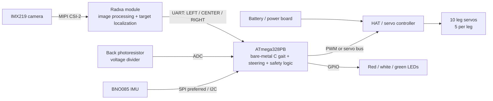

<div align="center">
<table style="display: inline-table; width: auto; max-width: 100%; text-align: left;">
  <thead>
    <tr>
      <th>Component</th>
      <th>Function</th>
      <th>Interface</th>
    </tr>
  </thead>
  <tbody>
    <tr>
      <td>ATmega328PB</td>
      <td>Runs bare-metal C for the state machine, gait scheduling, and servo steering toward the target based on the left/center/right result; also handles light detection, attitude safety, LED control, and faults</td>
      <td>GPIO, ADC, timers, SPI/I2C, UART, servo interface</td>
    </tr>
    <tr>
      <td>Radxa module</td>
      <td>Processes camera frames, detects a red target or another specified target, and outputs its left, center, or right position</td>
      <td>MIPI CSI-2 camera input; UART to ATmega328PB</td>
    </tr>
    <tr>
      <td>IMX219 camera</td>
      <td>Captures forward-facing images for red-target or specified-target detection</td>
      <td>MIPI CSI-2 to Radxa module</td>
    </tr>
    <tr>
      <td>Ten leg servos, five per leg</td>
      <td>Hip, knee, and ankle motion for weight transfer, swing, clearance, and foot leveling</td>
      <td>PWM or servo bus</td>
    </tr>
    <tr>
      <td>BNO085 IMU</td>
      <td>Roll, pitch, rotation vector, and motion status</td>
      <td>SPI preferred; I2C acceptable</td>
    </tr>
    <tr>
      <td>Photoresistor</td>
      <td>Detects whether a hand covers the robot's back</td>
      <td>Analog voltage divider to ADC</td>
    </tr>
    <tr>
      <td>Red, white, and green LEDs</td>
      <td>Indicate operating state and faults</td>
      <td>GPIO</td>
    </tr>
    <tr>
      <td>HAT / servo controller</td>
      <td>Power distribution, interface expansion, level shifting, and low-level servo transport</td>
      <td>Hardware dependent</td>
    </tr>
  </tbody>
</table>
</div>

### 4. Design Sketches

<p align="center">
  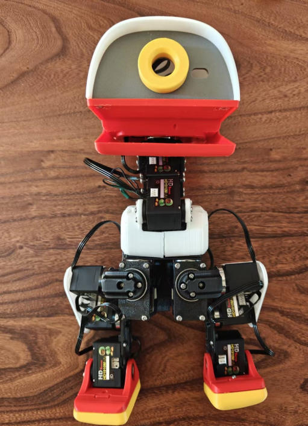
  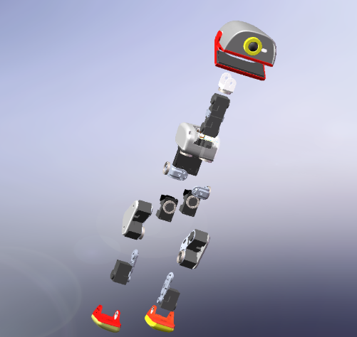
</p>
<p align="center"><em>Overall assembly (left) and exploded view (right).</em></p>

#### Ten-Servo Leg Layout

The two legs use ten servos in total: five active joints per leg.

<div align="center">
<table style="display: inline-table; width: auto; max-width: 100%; text-align: left;">
  <thead>
    <tr>
      <th>Servo</th>
      <th>Mechanical Role</th>
    </tr>
  </thead>
  <tbody>
    <tr>
      <td>Left hip roll servo</td>
      <td>Tilts the pelvis laterally and transfers the center of mass toward the left foot</td>
    </tr>
    <tr>
      <td>Left hip pitch servo</td>
      <td>Moves the left thigh forward and backward</td>
    </tr>
    <tr>
      <td>Left knee pitch servo</td>
      <td>Bends the leg to provide foot clearance during swing</td>
    </tr>
    <tr>
      <td>Left ankle pitch servo</td>
      <td>Levels the left foot for landing and push-off</td>
    </tr>
    <tr>
      <td>Left ankle roll servo</td>
      <td>Maintains lateral foot contact during weight transfer</td>
    </tr>
    <tr>
      <td>Right hip roll servo</td>
      <td>Tilts the pelvis laterally and transfers the center of mass toward the right foot</td>
    </tr>
    <tr>
      <td>Right hip pitch servo</td>
      <td>Moves the right thigh forward and backward</td>
    </tr>
    <tr>
      <td>Right knee pitch servo</td>
      <td>Bends the leg to provide foot clearance during swing</td>
    </tr>
    <tr>
      <td>Right ankle pitch servo</td>
      <td>Levels the right foot for landing and push-off</td>
    </tr>
    <tr>
      <td>Right ankle roll servo</td>
      <td>Maintains lateral foot contact during weight transfer</td>
    </tr>
  </tbody>
</table>
</div>

<p align="center">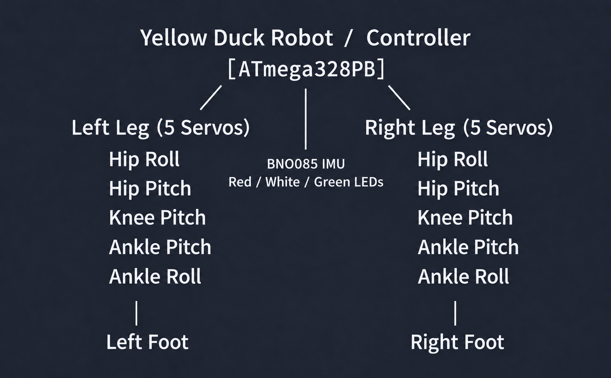</p>

#### Walking Cycle

1. Lean the pelvis to the left using the hip-roll joints and transfer the center of mass onto the left foot.
2. Flex the right knee, swing the right hip forward, and level the right foot with the ankle joints.
3. Extend the right knee and return the pelvis toward the center so the right foot lands in double support.
4. Lean the pelvis to the right and transfer the center of mass onto the right foot.
5. Flex the left knee, swing the left hip forward, and level the left foot with the ankle joints.
6. Extend the left knee and return the pelvis toward the center so the left foot lands and the cycle repeats.

The first tuning objective is reliable center-of-mass transfer. Stride length should remain small until the robot can repeatedly shift its weight without falling.

#### Photoresistor Stop Control

The photoresistor is planned to be mounted on the robot's back in a location that can be consistently covered by one hand. It has not yet been installed on the physical robot.

#### Circuit Design

<p align="center">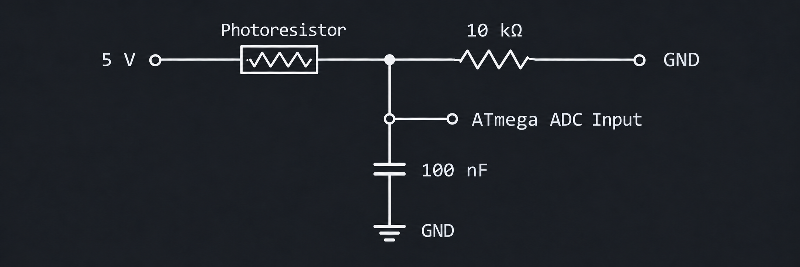</p>

#### Signal Processing

<div align="center">
<table style="display: inline-table; width: auto; max-width: 100%; text-align: left;">
  <thead>
    <tr>
      <th>Parameter</th>
      <th>Initial Value</th>
    </tr>
  </thead>
  <tbody>
    <tr>
      <td>ADC sampling rate</td>
      <td>100 Hz, one sample every 10 ms</td>
    </tr>
    <tr>
      <td>Digital filter</td>
      <td>8-sample moving average or equivalent IIR filter</td>
    </tr>
    <tr>
      <td>Startup calibration</td>
      <td>2 seconds with the sensor uncovered</td>
    </tr>
    <tr>
      <td>Stop threshold</td>
      <td>40% of the uncovered baseline</td>
    </tr>
    <tr>
      <td>Resume threshold</td>
      <td>60% of the uncovered baseline</td>
    </tr>
    <tr>
      <td>Cover confirmation time</td>
      <td>200 ms</td>
    </tr>
    <tr>
      <td>Resume confirmation time</td>
      <td>500 ms</td>
    </tr>
  </tbody>
</table>
</div>

The separate stop and resume thresholds provide hysteresis. The ambient-light baseline must be frozen while the sensor is covered so that the covered state cannot be learned as a new normal condition.

#### Safe Stop Behavior

When a cover is confirmed, the robot must:

1. Refuse to begin another half-step.
2. Complete the current half-step and reach double support.
3. Return smoothly to the neutral standing pose within a target of 0.5 seconds.
4. Enter `STOPPED` and illuminate the white LED.

After the sensor has remained uncovered for 500 ms, the robot checks the BNO085 safety conditions. If the posture is safe, walking resumes automatically.

#### BNO085 Attitude Protection

The IMU is used for monitoring and safety rather than complex dynamic balance.

<div align="center">
<table style="display: inline-table; width: auto; max-width: 100%; text-align: left;">
  <thead>
    <tr>
      <th>Condition</th>
      <th>Initial Threshold</th>
      <th>Response</th>
    </tr>
  </thead>
  <tbody>
    <tr>
      <td>Normal</td>
      <td>Absolute roll and pitch below 15 degrees</td>
      <td>Continue walking</td>
    </tr>
    <tr>
      <td>Warning</td>
      <td>Absolute roll or pitch between 15 and 25 degrees</td>
      <td>Reduce stride and stop after the current half-step</td>
    </tr>
    <tr>
      <td>Fall</td>
      <td>Absolute roll or pitch above 25 degrees</td>
      <td>Enter <code>FALL</code> and stop gait generation</td>
    </tr>
    <tr>
      <td>Recovery</td>
      <td>Absolute roll and pitch below 10 degrees for 1 second</td>
      <td>Permit re-standing</td>
    </tr>
  </tbody>
</table>
</div>

The BNO085 should be read at 25-50 Hz. Thresholds must be tuned experimentally after the final mechanical structure is assembled. A BNO085 timeout or communication failure must prohibit walking.

#### Operating State Machine

<div align="center">
<table style="display: inline-table; width: auto; max-width: 100%; text-align: left;">
  <thead>
    <tr>
      <th>State</th>
      <th>Behavior</th>
      <th>Exit Condition</th>
    </tr>
  </thead>
  <tbody>
    <tr>
      <td><code>BOOT</code></td>
      <td>Initialize clocks, GPIO, ADC, timers, and communication interfaces</td>
      <td>Initialization complete</td>
    </tr>
    <tr>
      <td><code>SELF_TEST</code></td>
      <td>Check the BNO085, photoresistor, and all ten servos</td>
      <td>All checks pass, otherwise <code>ERROR</code></td>
    </tr>
    <tr>
      <td><code>STAND</code></td>
      <td>Move smoothly to a neutral standing pose over 2-3 seconds</td>
      <td>Stable posture confirmed</td>
    </tr>
    <tr>
      <td><code>WALKING</code></td>
      <td>Execute the keyframe gait while light and attitude conditions are safe</td>
      <td>Cover, fall, or fault detected</td>
    </tr>
    <tr>
      <td><code>FINISH_STEP</code></td>
      <td>Complete the current half-step and return to double support</td>
      <td>Neutral pose reached</td>
    </tr>
    <tr>
      <td><code>STOPPED</code></td>
      <td>Hold a safe standing pose and illuminate the white LED</td>
      <td>Light restored and posture safe</td>
    </tr>
    <tr>
      <td><code>FALL</code></td>
      <td>Stop gait generation and illuminate the red LED</td>
      <td>Manual restoration and safety reconfirmation</td>
    </tr>
    <tr>
      <td><code>ERROR</code></td>
      <td>Prohibit walking and display a fault indication</td>
      <td>Fault cleared and system reinitialized</td>
    </tr>
  </tbody>
</table>
</div>

The main transition sequence is:

```text
BOOT -> SELF_TEST -> STAND -> WALKING
WALKING -> cover detected -> FINISH_STEP -> STOPPED
STOPPED -> light restored and posture safe -> WALKING
Any motion state -> excessive tilt or communication fault -> FALL / ERROR
```

#### LED Status Definitions

<div align="center">
<table style="display: inline-table; width: auto; max-width: 100%; text-align: left;">
  <thead>
    <tr>
      <th>LED</th>
      <th>Meaning</th>
    </tr>
  </thead>
  <tbody>
    <tr>
      <td>White</td>
      <td>Initialization, standing, or covered/stopped</td>
    </tr>
    <tr>
      <td>Green</td>
      <td>Walking normally</td>
    </tr>
    <tr>
      <td>Red</td>
      <td>Fall condition or system fault</td>
    </tr>
  </tbody>
</table>
</div>

#### Firmware Architecture

Long blocking delays must not be used. A timer-driven scheduler coordinates all periodic tasks.

<div align="center">
<table style="display: inline-table; width: auto; max-width: 100%; text-align: left;">
  <thead>
    <tr>
      <th>Module</th>
      <th>Responsibility</th>
      <th>Nominal Rate</th>
    </tr>
  </thead>
  <tbody>
    <tr>
      <td><code>timer.c</code></td>
      <td>1 ms system tick and scheduler timing</td>
      <td>1 kHz</td>
    </tr>
    <tr>
      <td><code>servo_bus.c</code></td>
      <td>Servo position, speed, and status exchange</td>
      <td>50 Hz</td>
    </tr>
    <tr>
      <td><code>gait.c</code></td>
      <td>Keyframes, interpolation, gait phase, and safe stopping</td>
      <td>50 Hz</td>
    </tr>
    <tr>
      <td><code>adc_light.c</code></td>
      <td>ADC acquisition for the photoresistor</td>
      <td>100 Hz</td>
    </tr>
    <tr>
      <td><code>light_filter.c</code></td>
      <td>Filtering, baseline calibration, hysteresis, and cover detection</td>
      <td>100 Hz</td>
    </tr>
    <tr>
      <td><code>bno085.c</code></td>
      <td>Attitude acquisition, timeout handling, and recovery checks</td>
      <td>25-50 Hz</td>
    </tr>
    <tr>
      <td><code>state_machine.c</code></td>
      <td>State transitions and safety coordination</td>
      <td>50 Hz</td>
    </tr>
    <tr>
      <td><code>status_led.c</code></td>
      <td>LED state and fault codes</td>
      <td>10 Hz</td>
    </tr>
  </tbody>
</table>
</div>

Suggested source layout:

```text
main.c
system_init.c
timer.c
adc_light.c
light_filter.c
bno085.c
servo_bus.c
gait.c
state_machine.c
status_led.c
fault.c
config.h
```

For PWM servos, timer compare interrupts should generate or schedule the output pulses. For bus servos, the timer scheduler should trigger periodic command updates.

#### Course Requirement Mapping

<div align="center">
<table style="display: inline-table; width: auto; max-width: 100%; text-align: left;">
  <thead>
    <tr>
      <th>Requirement</th>
      <th>Project Implementation</th>
    </tr>
  </thead>
  <tbody>
    <tr>
      <td>At least two input devices</td>
      <td>BNO085 IMU and back-mounted photoresistor</td>
    </tr>
    <tr>
      <td>At least one analog input</td>
      <td>Photoresistor voltage divider connected to the ATmega ADC</td>
    </tr>
    <tr>
      <td>At least two output device classes</td>
      <td>Ten-servo motion system and red/white/green LEDs</td>
    </tr>
    <tr>
      <td>I2C or SPI peripheral</td>
      <td>BNO085, with SPI preferred</td>
    </tr>
    <tr>
      <td>Bare-metal register-level C</td>
      <td>Direct configuration of GPIO, ADC, timers, interrupts, and communication peripherals</td>
    </tr>
    <tr>
      <td>Integrated system</td>
      <td>Mechanical biped, servos, power, HAT, sensors, state machine, and safety logic</td>
    </tr>
  </tbody>
</table>
</div>

The project directly demonstrates at least three technical topics:

- **Timers:** 1 ms system tick, 20 ms servo update, gait phase timing, and cover-duration timing.
- **Interrupts:** timer compare, ADC completion, and optional servo receive interrupts.
- **Noise filtering and signal conditioning:** analog RC filtering, digital filtering, hysteresis, and attitude smoothing.

Timer frequencies and interrupt response should be verified with a logic analyzer or diagnostic GPIO pulse. Photoresistor data should be recorded before and after filtering to demonstrate reduced noise and false triggering.

### 5. SRS — Software Requirements Specification

<div align="center">
<table style="display: inline-table; width: auto; max-width: 100%; text-align: left;">
  <thead>
    <tr>
      <th>ID</th>
      <th>Requirement</th>
    </tr>
  </thead>
  <tbody>
    <tr>
      <td>SRS-01</td>
      <td>The system shall complete its startup self-test and reach a standing pose within 5 seconds after power-on.</td>
    </tr>
    <tr>
      <td>SRS-02</td>
      <td>The system shall sample the photoresistor at no less than 100 Hz and digitally filter the signal.</td>
    </tr>
    <tr>
      <td>SRS-03</td>
      <td>If the filtered light value remains below the stop threshold for 200 ms, the robot shall stop safely within 0.5 seconds.</td>
    </tr>
    <tr>
      <td>SRS-04</td>
      <td>If the filtered light value remains above the resume threshold for 500 ms and the posture is safe, the robot shall resume walking automatically.</td>
    </tr>
    <tr>
      <td>SRS-05</td>
      <td>The system shall acquire BNO085 attitude data at no less than 25 Hz.</td>
    </tr>
    <tr>
      <td>SRS-06</td>
      <td>If roll or pitch exceeds the fall threshold, the robot shall stop gait generation within 200 ms.</td>
    </tr>
    <tr>
      <td>SRS-07</td>
      <td>The MuJoCo simulation shall support keyboard-controlled forward, backward, and turning movements of the virtual robot.</td>
    </tr>
    <tr>
      <td>SRS-08</td>
      <td>The LEDs shall distinguish initialization, walking, covered/stopped, and fault states.</td>
    </tr>
  </tbody>
</table>
</div>

### 6. HRS — Hardware Requirements Specification

<div align="center">
<table style="display: inline-table; width: auto; max-width: 100%; text-align: left;">
  <thead>
    <tr>
      <th>ID</th>
      <th>Requirement</th>
    </tr>
  </thead>
  <tbody>
    <tr>
      <td>HRS-01</td>
      <td>The mechanical design shall define mounting positions for all ten leg servos, with five actuated joints per leg covering hip, knee, and ankle motion.</td>
    </tr>
    <tr>
      <td>HRS-02</td>
      <td>The average ADC readings in covered and uncovered conditions shall differ by at least 30%.</td>
    </tr>
    <tr>
      <td>HRS-03</td>
      <td>The servo system and the red/white/green LEDs shall constitute two output device classes.</td>
    </tr>
    <tr>
      <td>HRS-04</td>
      <td>Simultaneous motion of all ten servos shall not reset the MCU or cause a sustained loss of sensor communication.</td>
    </tr>
    <tr>
      <td>HRS-05</td>
      <td>The robot shall complete at least 10 consecutive steps on a level surface using all ten leg servos.</td>
    </tr>
    <tr>
      <td>HRS-06</td>
      <td>The stopped robot shall remain in double support for 30 seconds without falling.</td>
    </tr>
  </tbody>
</table>
</div>

### 7. Bill of Materials (BOM)

[Project BOM spreadsheet](https://github.com/upenn-embedded/ese5190f26-finalproject-t29/blob/main/BOM.xlsx)

### 8. Final Demo

<div align="center">
<table style="display: inline-table; width: auto; max-width: 100%; text-align: left;">
  <thead>
    <tr>
      <th>Test</th>
      <th>Procedure</th>
      <th>Acceptance Criterion</th>
    </tr>
  </thead>
  <tbody>
    <tr>
      <td>Standing</td>
      <td>Enter <code>STAND</code> and record the robot</td>
      <td>No fall for 30 seconds</td>
    </tr>
    <tr>
      <td>Walking</td>
      <td>Mark the start position and count steps</td>
      <td>At least 10 consecutive steps or 0.5 m travel</td>
    </tr>
    <tr>
      <td>Covered stop</td>
      <td>Cover the sensor at random gait phases for 10 trials</td>
      <td>Safe stop within 0.5 seconds in every trial</td>
    </tr>
    <tr>
      <td>Automatic resume</td>
      <td>Remove the hand after a sustained cover for 10 trials</td>
      <td>Resume after 500 ms of stable light in at least 90% of trials</td>
    </tr>
    <tr>
      <td>Light-noise rejection</td>
      <td>Change ambient light and cast brief shadows</td>
      <td>No sustained stop caused by non-hand light disturbances</td>
    </tr>
    <tr>
      <td>Fall protection</td>
      <td>Tilt the robot beyond the configured threshold</td>
      <td>Gait stops within 200 ms and the red LED turns on</td>
    </tr>
    <tr>
      <td>Power integrity</td>
      <td>Run all ten servos for 5 minutes</td>
      <td>No MCU reset or sustained communication loss</td>
    </tr>
  </tbody>
</table>
</div>

#### Demonstration Sequence

1. Power on; the white LED indicates initialization.
2. The robot moves smoothly into its standing pose.
3. The green LED turns on and the robot begins walking.
4. A hand covers the photoresistor on the robot's back.
5. The robot completes the current half-step, reaches double support, stops, and turns on the white LED.
6. The hand is removed and the robot resumes walking after the resume condition is satisfied.
7. The robot is tilted beyond the fall threshold; gait stops and the red LED turns on.

#### Key Risks and Mitigations

<div align="center">
<table style="display: inline-table; width: auto; max-width: 100%; text-align: left;">
  <thead>
    <tr>
      <th>Risk</th>
      <th>Mitigation</th>
    </tr>
  </thead>
  <tbody>
    <tr>
      <td>Ten active joints cause gait coupling or mechanical interference</td>
      <td>Start with small joint ranges, tune one leg phase at a time, and enforce joint limits in firmware</td>
    </tr>
    <tr>
      <td>Knee or ankle joints back-drive under load</td>
      <td>Use rigid mechanical stops where needed and hold safe support poses with active servo torque</td>
    </tr>
    <tr>
      <td>Light noise causes stop/resume oscillation</td>
      <td>Use RC filtering, digital filtering, 200 ms confirmation, and hysteresis</td>
    </tr>
    <tr>
      <td>Immediate stopping causes a fall</td>
      <td>Complete the current half-step unless an attitude fault requires an emergency stop</td>
    </tr>
    <tr>
      <td>Servo startup current resets the MCU</td>
      <td>Separate servo and logic rails as appropriate, use a common ground, add bulk capacitance, and limit simultaneous acceleration</td>
    </tr>
    <tr>
      <td>BNO085 communication fails</td>
      <td>Prefer SPI, implement timeouts and bus recovery, and prohibit walking during failure</td>
    </tr>
    <tr>
      <td>HAT responsibilities are unclear</td>
      <td>Verify the schematic and keep all application decisions on the ATmega328PB</td>
    </tr>
  </tbody>
</table>
</div>

### 9. Sprint Planning

#### Team Responsibilities

| Team Member | Primary Responsibilities | Planned Deliverables |
|---|---|---|
| Zichao Di | MuJoCo simulation, gait design, coordinated leg motion, and motion-control development | Simulation results, gait parameters, and motion-control demonstrations |
| Lingran Zhang | Mechanical assembly, servo mounting, and physical single-servo testing | Mechanical assembly evidence and servo test documentation |
| Yixuan Ji | Sensor interfaces, bare-metal firmware, and safety integration | Sensor interface code, test records, and integration progress |

#### Expected Development Order

1. Verify one servo and its low-level control interface.
2. Assemble the mechanical structure and achieve a stable standing pose.
3. Tune stationary lateral center-of-mass transfer.
4. Implement and validate one complete step.
5. Extend the gait to at least 10 continuous steps.
6. Add photoresistor stop/resume control and repeat the test 10 times.
7. Add BNO085 attitude protection and communication-fault handling.
8. Perform a final 5-minute integration test with all ten servos active.

#### Sprint Milestones

| Milestone  | Functionality Achieved                                                                                 | Distribution of Work                     |
| ---------- | ------------------------------------------------------------------------------------------------------ | ---------------------------------------- |
| Sprint #1  | Review BOM and power architecture; define ten-servo mechanical layout; begin physical assembly and simulation; attempt initial servo control | BOM and power design status, mechanical photos, and simulation videos; physical single-servo test deferred |
| Sprint #2  | Assemble both legs; complete BNO085 and photoresistor drivers                                          | Standing-pose video and sensor logs      |
| MVP Demo   | Implement keyframe gait and reach 10 consecutive steps                                                 | Walking video and step-count log         |
| Final Demo | Integrate safe stop/resume, fall protection, and final quantitative validation                         | Final demo video and test table          |

#### Definition of Done

The minimum viable project is complete when the robot can:

- Power on, pass self-test, and stand within 5 seconds.
- Walk at least 10 consecutive steps on a level surface.
- Stop safely when the back photoresistor is covered.
- Remain stopped in double support without falling.
- Resume walking automatically when the sensor is uncovered and the posture is safe.
- Stop motion and display a red fault indication after excessive tilt or a BNO085 communication failure.
- Operate all ten servos without resetting the controller or losing sensor communication.

#### Optional Advanced Version (Time Permitting)

After the ten-servo baseline has achieved all required objectives, the team may build an advanced fifteen-servo version if sufficient time remains.

- Fifteen-servo body: Extend the mechanical design from ten to fifteen servos for additional joints and more expressive motion.
- Microphone: Trigger actions from clapping, sound intensity, or a keyword.

> Implementation note: Hugging Face hosts openly available models and algorithms for audio interaction. Therefore, the advanced version can focus on adapting an appropriate existing model to the physical robot, including microphone input, embedded deployment, and validation, rather than training a model from scratch.

**This is the end of the Project Proposal section. The remaining sections will be filled out based on the milestone schedule.**

## Sprint Review #1 — November 13, 2026

### Last week's progress

**Mechanical design and assembly.** We determined the mounting positions and mechanical structures for all ten servos, with five planned actuated joints per leg. We also began physical assembly of the lower body by installing servos into foot housings and joint brackets and connecting portions of the left and right leg structures. This is a **partial mechanical prototype**, not a completed or powered walking robot. The physical servos have not yet been powered or motion-tested.

**MuJoCo simulation.** We used a virtual duck-robot model in MuJoCo to demonstrate keyboard-controlled **forward, backward, and turning** movements. Two videos document these three motion commands. These results establish virtual motion control only; they do not demonstrate physical walking, gait stability, or embedded servo-control firmware.

**Planning and work completed.** The project BOM has been reviewed, and the power architecture has been determined. Some required components have arrived, but others are still outstanding. The planned single-servo physical control demonstration was **not completed** during Sprint #1; it remains a next-sprint task.

**Proof of work.** The following seven photographs document partial mechanical assembly. The two videos document the confirmed keyboard-controlled MuJoCo motion demonstrations.

#### Mechanical assembly photographs

| Photo | Evidence |
|---|---|
| 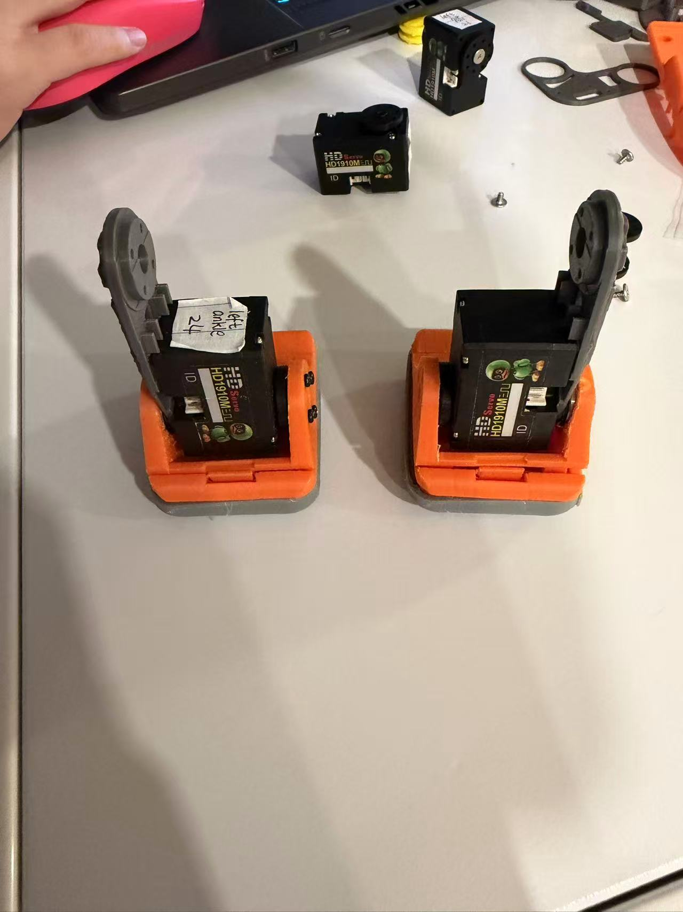 | **Photo 1:** Servos installed in foot bases. |
| 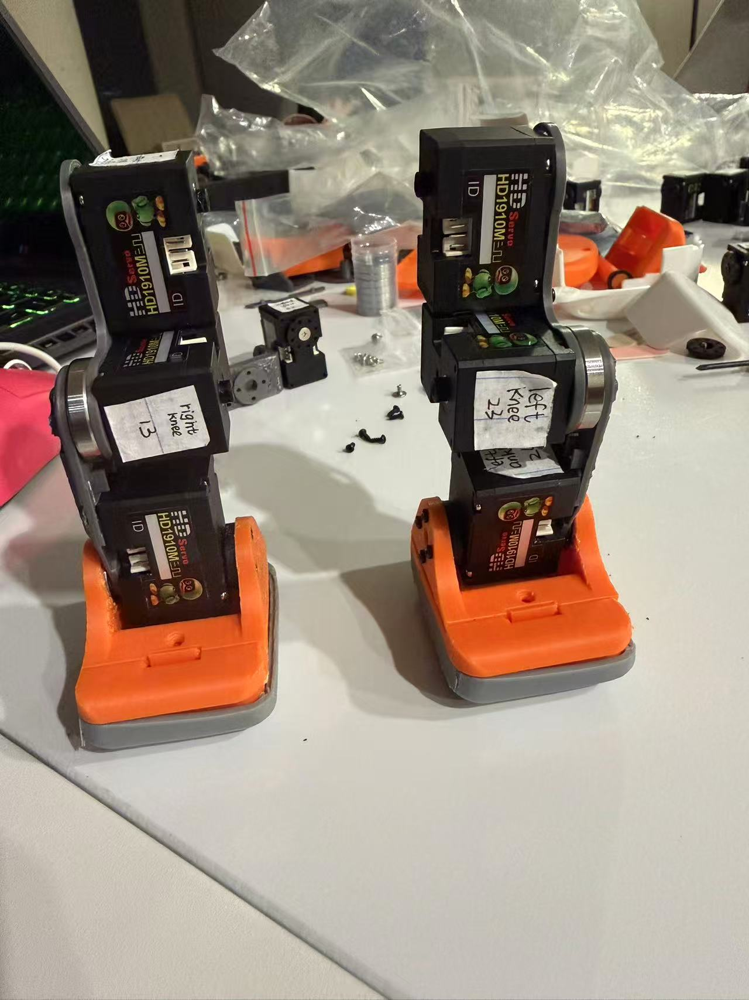 | **Photo 2:** Partially assembled left and right legs with joint labels. |
| 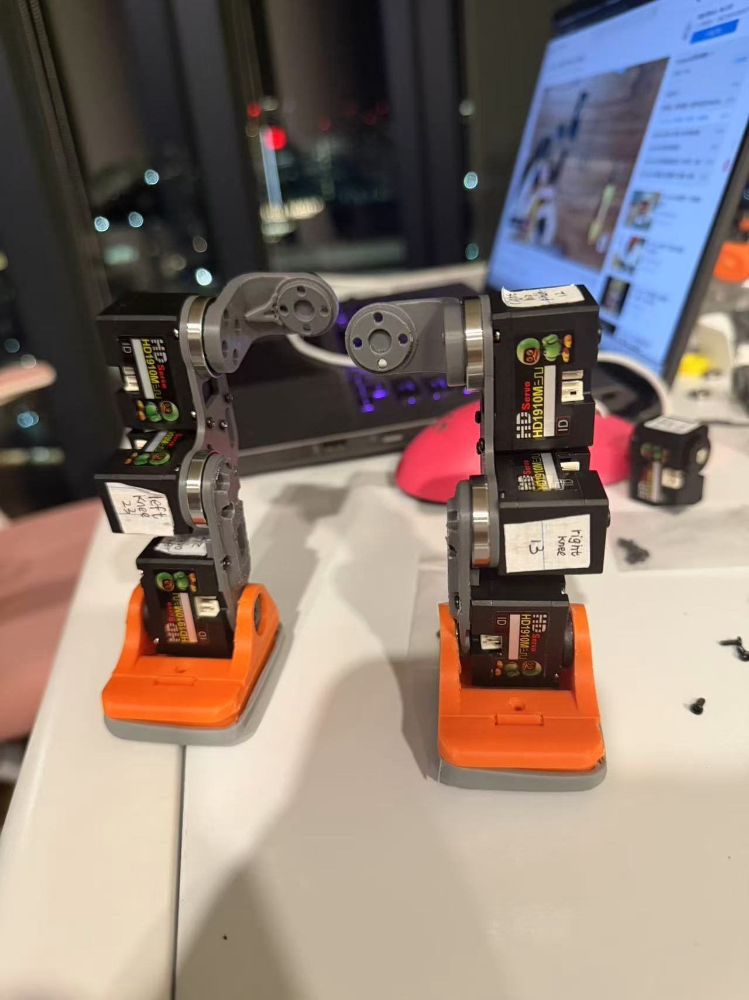 | **Photo 3:** Preliminary connection between leg structures. |
| 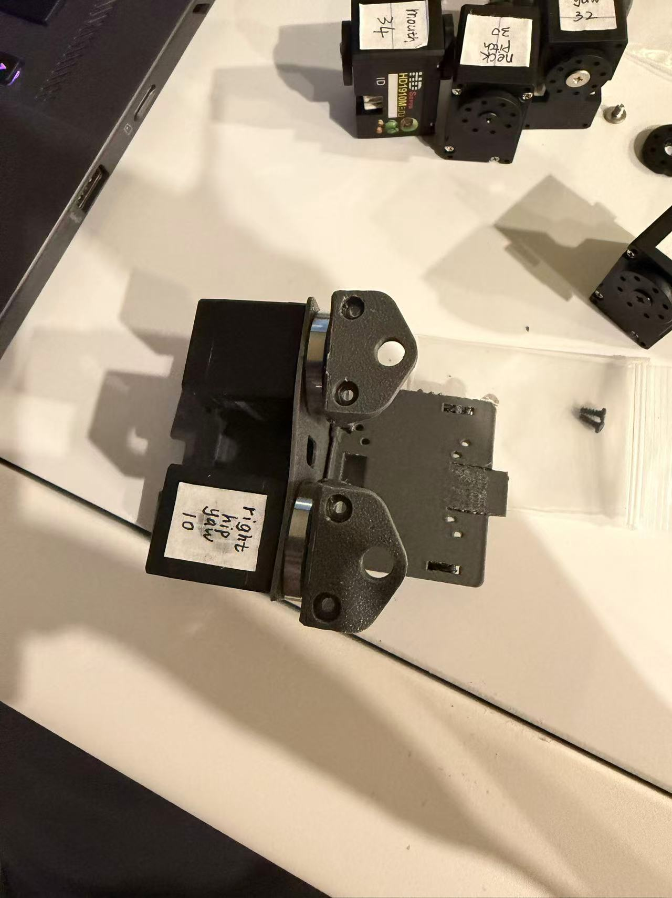 | **Photo 4:** Servo and joint-bracket assembly detail. |
| 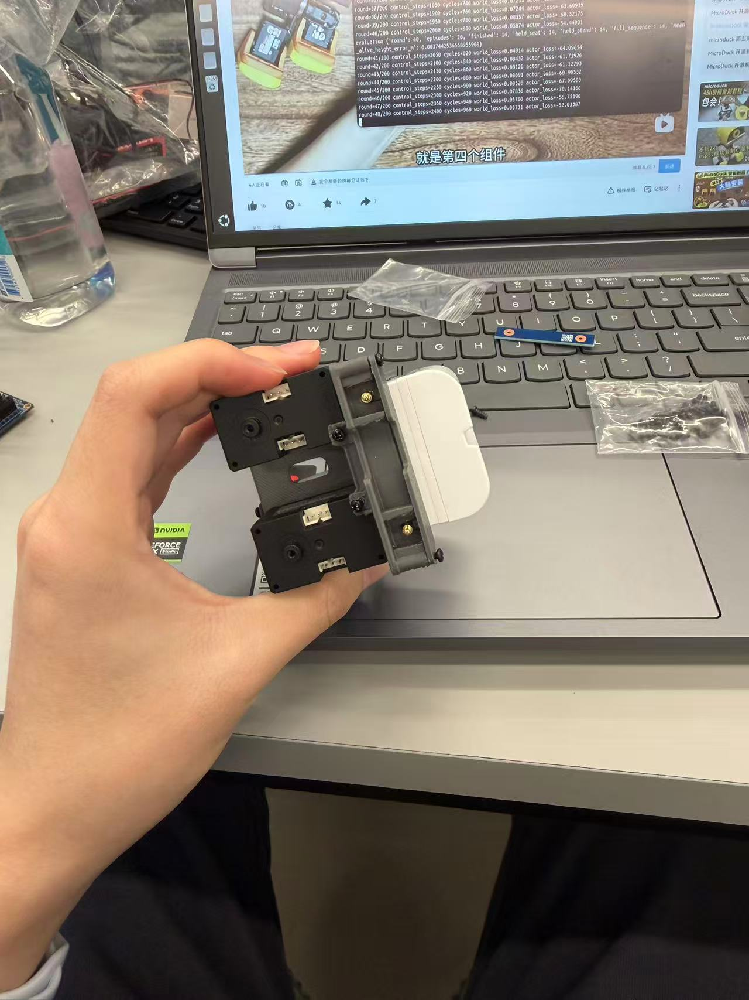 | **Photo 5:** Servo placement in a foot-related component. |
| 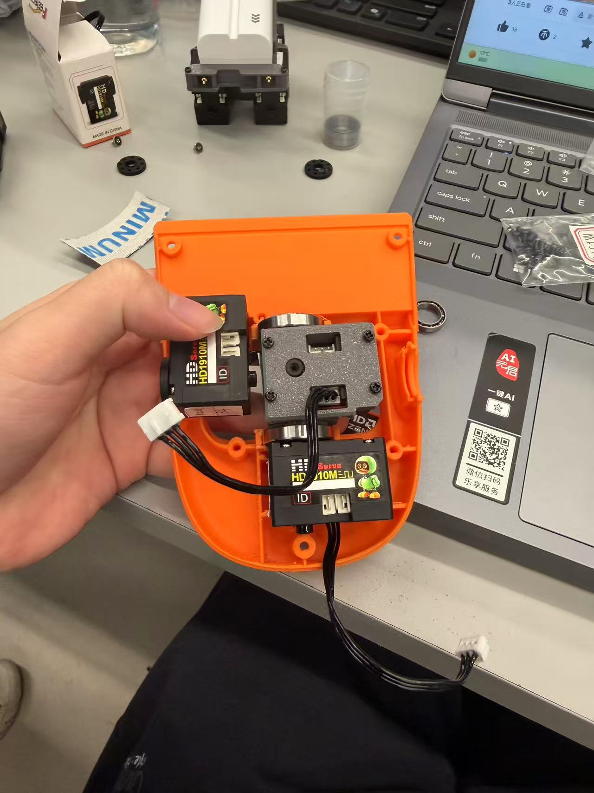 | **Photo 6:** Servos and cables positioned inside a foot housing. |
| 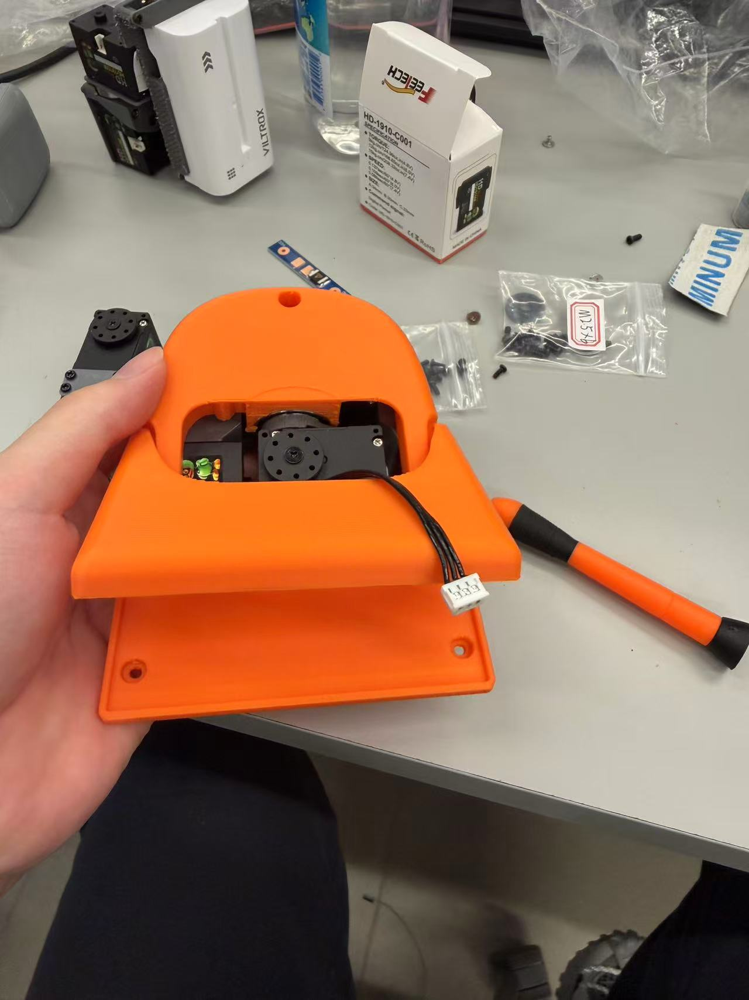 | **Photo 7:** Foot housing positioned around the servo assembly. |

#### Keyboard-controlled simulation videos

- [Simulation video 1 — keyboard control demonstration](videos/sprint1/01_keyboard_control_simulation.mp4)
- [Simulation video 2 — keyboard motion demonstration](videos/sprint1/02_keyboard_motion_simulation.mp4)

### HRS Verification — Sprint #1

**HRS-01 — Ten-servo mechanical layout**

**Requirement:** The mechanical design shall define mounting positions for all ten leg servos, with five actuated joints per leg covering hip, knee, and ankle motion.

**Verification method:** Review the ten-servo leg layout and the assigned joints for each leg. Compare the planned mounting positions with the mechanical design and document the partially assembled structures using the photographs above.

**Result: Verified at the mechanical-design level.** All ten servo mounting positions and corresponding mechanical structures have been determined. The ten-servo leg layout is documented in the Project Proposal, and the photographs show the partial physical implementation. **This verification does not establish that all ten servos are installed, powered, or able to move.**

### SRS Verification — Sprint #1

**SRS-07 — Keyboard-controlled MuJoCo simulation**

**Requirement:** The MuJoCo simulation shall support keyboard-controlled forward, backward, and turning movements of the virtual robot.

**Verification method:** Use keyboard inputs in MuJoCo to command forward, backward, and turning movements, and document the observed virtual robot motion in video recordings.

**Result: Verified at the simulation level.** Forward, backward, and turning movements were demonstrated in MuJoCo. The two linked simulation videos document these movements. **This verification does not establish stable physical walking or operation of the ATmega328PB servo-control firmware.**

### Current state of project

The project is in the **mechanical prototyping and simulation** stage. The ten-servo mechanical layout has been defined, and parts of the leg and foot structures have been assembled. The BOM has been reviewed, and the power architecture has been determined. **Only some of the required components have arrived; others are still outstanding.** The photoresistor has not yet been installed on the physical robot.

MuJoCo keyboard control has demonstrated forward, backward, and turning movements. Physical servos have not yet been powered or motion-tested, and a physical single-servo control demonstration has not been completed. Physical walking, sensor integration, and safe stop/resume have not yet been demonstrated.

**Challenges and next steps:** Complete the mechanical assembly, establish controlled movement of a physical servo, and begin sensor interface testing. The motion-control work must eventually be transferred from the simulation to physical hardware and validated there.

### Next week's plan

For Sprint 2, work is divided into three areas with assigned owners and measurable completion criteria.

| Task | Estimated Time | Assigned Team Member | Definition of Done |
|---|---|---|---|
| **1. Simulation & Motion Control:** Refine MuJoCo forward, backward, and turning control; investigate coordinated joint motion and initial gait parameters for eventual physical implementation. | 8–12 hours | Zichao Di | Document the updated simulation behavior and identify initial gait parameters or motion sequences for subsequent hardware implementation. |
| **2. Mechanical Assembly & Servo Testing:** Continue assembly of legs, feet, and joints; power and command one physical servo; inspect its range of motion. | 6–8 hours | Lingran Zhang | Document the planned assembly progress and demonstrate controlled motion of at least one physical servo, with photos or video. |
| **3. Sensors, Firmware & Safety Integration:** Begin ATmega328PB interfaces for the photoresistor and BNO085 and establish basic firmware structure for future safety logic. | 6–8 hours | Yixuan Ji | Implement and test at least one sensor interface and document its readings or communication results. |

**Sprint 2 verification target:** Document verification of at least one hardware requirement and one software requirement using evidence appropriate to their stated acceptance criteria.


## Sprint Review #2 — November 20, 2026

### Last week's progress

**Mechanical assembly.** During Sprint 2, we completed the remaining mechanical assembly work that was unfinished in Sprint 1. The robot's main body, left and right legs, feet, and joint structures have now been assembled into a complete physical prototype. All ten servos have been installed in their planned mechanical positions, with five servos assigned to each leg. This represents significant progress from the partially assembled lower-body structure documented in Sprint 1.


**Standing Demonstration.** During Sprint 2, we achieved an initial standing configuration of the physical duck robot. The assembled robot can stand upright on both feet, demonstrating that the completed mechanical structure can support a standing posture. However, the robot is not yet fully stable and still requires further adjustments to improve its balance and standing reliability. Improving standing stability will be a priority in the next sprint.


**MuJoCo simulation.** We completed the planned simulation work for Sprint 2.

[Simulation details and demonstration results will be added after reviewing the Sprint 2 videos.]

**Project management and coordination.** We met with our project manager to review the current project status and discuss our progress. The meeting provided an opportunity to evaluate the completed mechanical assembly and simulation work and identify priorities for the next sprint.

**Proof of work.** Photographic evidence documents the completed mechanical assembly and initial standing configuration. Additional simulation videos will be included to document the software progress.

#### Mechanical assembly and standing photographs

| Photo | Evidence |
|---|---|
|  | **Photo 1:** Completed physical assembly of the duck robot, showing the main body, both legs, feet, and installed servos in an upright standing configuration. |

#### MuJoCo simulation videos

[To be added after reviewing the Sprint 2 simulation videos.]

### HRS Verification — Sprint #2

**HRS-01 — Ten-servo mechanical layout**

**Requirement:** The mechanical design shall define mounting positions for all ten leg servos, with five actuated joints per leg covering hip, knee, and ankle motion.

**Verification method:** Inspect the completed mechanical assembly and compare the physical servo mounting positions with the ten-servo leg layout documented in the Project Proposal. Verify that the left and right leg structures contain the planned servo mounting locations and that the servos are installed within the assembled mechanical framework. Document the completed assembly using photographs.

**Result: Verified at the mechanical-assembly level.** All ten servos have been installed in the planned mechanical structure, with five servos assigned to each leg. The previously incomplete leg and foot assemblies have been connected to the robot's main body, forming a complete physical prototype. The Sprint 2 photograph provides visual evidence of the assembled robot. This extends the Sprint 1 verification from mechanical design and partial assembly to completed physical assembly.


**HRS-06 — Standing stability**

**Requirement:** The stopped robot shall remain in double support for 30 seconds without falling.

**Verification method:** Place the fully assembled robot on a level surface with both feet supporting the body. Observe whether the robot can maintain an upright standing configuration. For full HRS-06 verification, conduct a timed 30-second standing test and document whether the robot remains upright throughout the test.

**Result: Partially achieved; further verification required.**During Sprint 2, the physical duck robot was able to stand upright on both feet after completing the mechanical assembly. This demonstrates initial progress toward the standing stability requirement.However, the robot's standing posture is not yet sufficiently stable, and further adjustments are needed to improve its balance. A successful 30-second standing test has not yet been documented.


### SRS Verification — Sprint #2

**SRS-07 — Keyboard-Controlled MuJoCo Simulation**

**Requirement:** The MuJoCo simulation shall support keyboard-controlled forward, backward, and turning movements of the virtual robot.

**Verification Method:** Run the MuJoCo simulation and evaluate the robot's movement behavior using the recorded simulation videos. Review the simulated leg movements, initial walking gait, and balance performance. Compare the Sprint 2 results with the keyboard-controlled movement demonstrations completed during Sprint 1.

**Result: Previously verified in Sprint 1; further simulation development completed in Sprint 2.**

During Sprint 2, we continued improving the MuJoCo simulation and exploring coordinated leg movements and basic walking gait development.

The first simulation video demonstrates alternating leg movements and an initial walking sequence, showing progress toward coordinated motion control.

The second video shows the robot losing balance and falling during simulation. This identifies a stability issue that requires further gait adjustment and improvement.

The third video demonstrates a simulation environment containing the robot and a ball, with visible ball movement. This provides additional evidence of simulation development, although the specific interaction and control mechanism have not yet been verified.

Overall, Sprint 2 achieved further progress in simulated motion development. However, improving walking stability and refining the coordinated leg movements remain important tasks for the next sprint.

**Simulation Evidence:**

- [Video 1: Walking Gait Simulation](videos/sprint2/01_walking_gait_simulation.mp4) — Demonstrates alternating leg movements and initial walking gait development.
- [Video 2: Balance and Fall Simulation](videos/sprint2/02_balance_and_fall_simulation.mp4) — Shows a balance failure during simulation, highlighting the need for improved stability.
- [Video 3: Robot and Ball Simulation](videos/sprint2/03_robot_and_ball_simulation.mp4) — Shows the robot and a moving ball within the MuJoCo simulation environment.


### Current state of project

The project has progressed from partial mechanical assembly to a fully assembled physical prototype. The main body, legs, feet, and ten-servo mechanical structure have been assembled, and an initial upright standing configuration has been demonstrated.

The Sprint 2 simulation work has also been completed. Detailed simulation results and corresponding software requirement verification will be documented using the demonstration videos.

The primary remaining challenge is to connect the completed mechanical structure with the control system and validate its behavior through physical testing. Although the robot has reached an upright standing configuration, controlled physical walking, timed standing stability, and the final sensor-based stop/resume functionality still require verification.

### Next week's plan

For Sprint 3, the proposed focus is to transition from completed mechanical assembly and simulation toward physical motion control, sensor integration, and systematic testing.

| Task | Estimated Time | Assigned Team Member | Definition of Done |
|---|---|---|---|
| **1. Simulation & Gait Development:** Refine the simulated walking gait, adjust joint motion sequences, and prepare initial motion parameters for physical implementation. | 8–12 hours | Zichao Di | Document an updated gait sequence and identify joint parameters that can be used as a starting point for physical servo control. |
| **2. Physical Servo Control & Standing Tests:** Begin controlled testing of the installed servos, inspect joint movement and mechanical limits, and evaluate the robot's standing stability. | 6–8 hours | Lingran Zhang | Demonstrate controlled physical servo movement, document test results, and perform a timed standing test toward HRS-06 verification. |
| **3. Sensor & Firmware Integration:** Continue developing the ATmega328PB interfaces for the photoresistor and BNO085 IMU and begin integrating sensor readings with the robot's safety-control logic. | 6–8 hours | Yixuan Ji | Demonstrate at least one working sensor interface and document the corresponding readings or communication results. |

**Sprint 3 Goal:** Begin connecting the completed physical robot with the control system, validate basic servo movement and standing stability, and continue developing the sensor interfaces required for safe stop/resume functionality.

**Requirement Verification Plan:** Prioritize the remaining standing-stability verification for HRS-06 and continue software requirement verification using documented simulation and firmware tests.


## MVP Demo

## Final Report

Don't forget to make the GitHub Pages public website!
If you've never made a GitHub Pages website before, follow this guide and substitute your final project repository for the GitHub username repository in the example: [GitHub Pages quickstart](https://docs.github.com/en/pages/quickstart).

### 1. Video

### 2. Images

### 3. Results

#### 3.1 Software Requirements Specification (SRS) Results

| ID | Description | Validation Outcome |
| -- | ----------- | ------------------ |
|    |             |                    |

#### 3.2 Hardware Requirements Specification (HRS) Results

| ID | Description | Validation Outcome |
| -- | ----------- | ------------------ |
|    |             |                    |

### 4. Conclusion

## References
